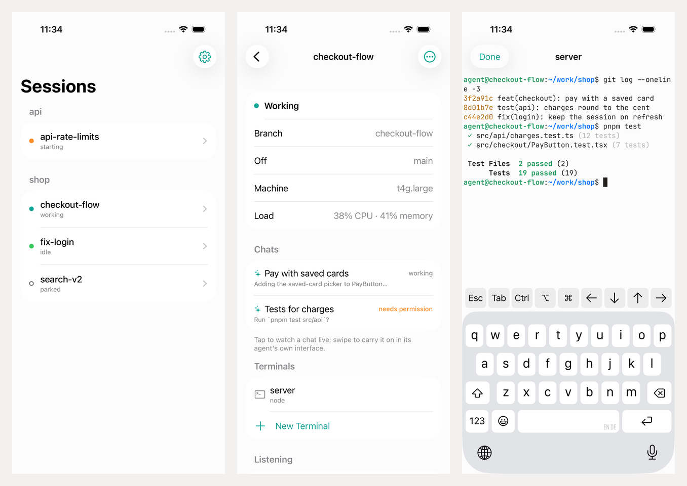

# pier for iOS

Your pier sessions from your phone. You can see them, wake or park them, follow
their agents' chats, and work in their terminals. Creating a session still
happens on the Mac, because a create uploads a snapshot of the local checkout.



## How it works

- **SwiftUI** app in `Sources/`. The project is generated from `project.yml`
  with XcodeGen, so don't edit `Pier.xcodeproj`.
- **`core/`** is the Go half, built with gomobile into `PierCore.xcframework`.
  It is its own module, so the CLI never builds the AWS SDK. It provides:
  - IAM Identity Center sign-in on the device (a device code you approve in the
    browser). The sign-in is kept in the Keychain on this device only.
  - The user's sessions, found by the tags the Mac's pier writes. It filters on
    the complete caller ARN, so two people on one permission set never see each
    other's sessions, and it skips unclaimed warm-pool members.
  - SSH to them. The session's own key lives on the Mac that created it, so the
    phone sends a key of its own through **EC2 Instance Connect** (good for 60
    seconds, long enough to log in). It also keeps **its own** TCP 22 rule in
    pier's security group, described `pier direct <user> ios`, so it never
    revokes the Mac's rule or the other way round.
  - tmux as the Mac's terminal tabs see it: grouped `pier-tab-*` sessions onto
    `main`, new windows in `~/work/<repo>`, the supervisor's status file, and
    `pier-supervisor chat window` to watch a chat or continue it in its agent's
    own interface.
- **Terminals** are Ghostty's own renderer (Metal) through libghostty.
  `Patches/` adds an external transport so it can be fed bytes from the core's
  SSH channel instead of a local PTY. A key bar over the keyboard supplies Esc,
  Tab, Ctrl, ⌥, ⌘ and the arrows.

## Building

Needs Xcode 26+ with its Metal toolchain
(`xcodebuild -downloadComponent MetalToolchain`), XcodeGen, Zig 0.16+ and
Go 1.26+. gomobile is pinned in `core/go.mod`.

```sh
cd ios
make run         # build the frameworks and the app, run it in the Simulator
make test        # the core's Go tests, the app's unit and UI tests
make build       # an unsigned device build
make testflight  # a signed App Store Connect IPA
```

The first `make` builds Ghostty from source, which takes a few minutes. Later
runs reuse it until the pinned commit or the patch changes.

`PIER_IOS_DEMO=1` (debug builds only) runs the app against made-up sessions
with no AWS behind them. The UI tests use it. `ios/.env.local` can prefill the
sign-in form for `make run`: `PIER_IOS_START_URL`, `PIER_IOS_SSO_REGION`,
`PIER_IOS_AWS_REGION`, `PIER_IOS_ACCOUNT_ID`, `PIER_IOS_ROLE_NAME`.

## What the AWS role needs

The phone does everything as the permission set you pick:
`ec2:DescribeInstances`, `ec2:StartInstances`, `ec2:StopInstances` and
`ec2:TerminateInstances` on your sessions; `ec2:DescribeSecurityGroupRules`,
`ec2:AuthorizeSecurityGroupIngress` and `ec2:RevokeSecurityGroupIngress` on
pier's group; and `ec2-instance-connect:SendSSHPublicKey`. That last one is the
only permission the Mac doesn't use.
